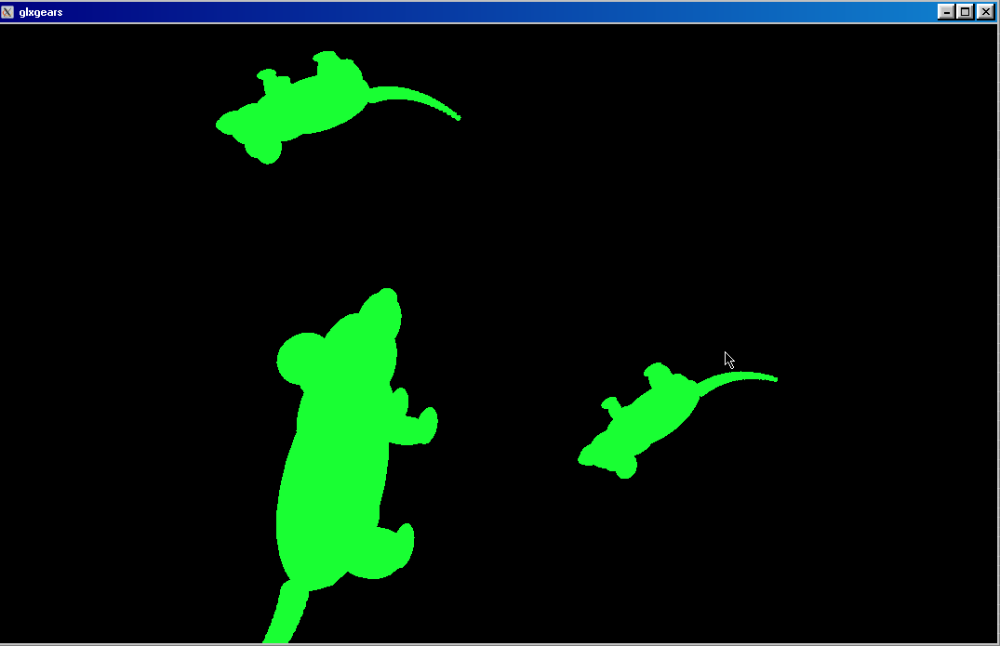

# glxrat

Turns the gears in glxgears into rats



## Build

Needs a stable Rust toolchain and Mesa's glxgears. On Arch:

```sh
pacman -S rust mesa-utils
```

```sh
./build.sh
```

Writes `glxrat.cdylib`.
